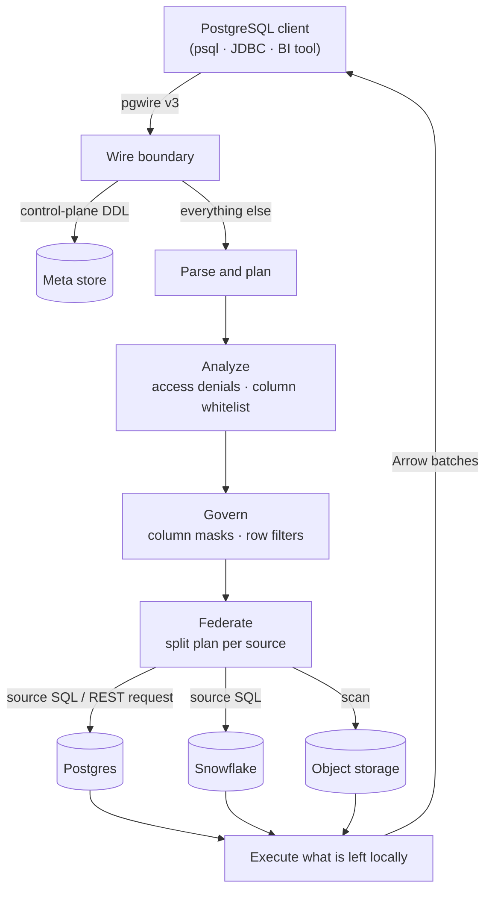

+++
title = "How Dataglot works"
description = "One PostgreSQL endpoint in front of many sources: how a query is parsed, governed, split across sources, and executed — and why nothing gets around a mask."
weight = 40
+++

Dataglot is a query engine, not a database. It stores none of your data.
It presents **one PostgreSQL endpoint**, resolves table names against the
sources you registered, rewrites the query plan to apply your governance
rules, pushes as much work as possible down into each source, and joins
whatever is left over locally.

Everything else on this page is detail about those five moves.

## One engine, three shapes

The same engine — same planner, same connectors, same policy path — ships
in three shapes:

| Shape | How you start it | What it is |
|---|---|---|
| **Server** | `dataglot --config dataglot.toml` | A pgwire listener on a port. Any PostgreSQL client connects. |
| **CLI / REPL** | `dataglot query …` · `dataglot shell` | The full engine **in-process** — no server, no port. See the [CLI reference](/docs/cli/). |
| **Distributed** | a `[ballista]` config block, on a `ballista`-enabled build | A scheduler plus N executors. Optional, feature-gated. |

They are not three implementations. The CLI is not a thin client, and the
distributed mode is not a different engine — governance, federation, and
name resolution are wired identically in all three. Anything true on this
page is true in each shape.

## The path of a query



### 1. The wire boundary

Dataglot speaks the **PostgreSQL v3 wire protocol**, so any Postgres
client or driver connects with no shim — see
[client compatibility](/docs/compatibility/).

Control-plane statements (`CREATE CATALOG`, `CREATE SECRET`,
`CREATE USER`, `CREATE MASK`, `GRANT`, …) are recognised **at the wire
boundary, before planning**, and routed to the control plane instead of
the query planner. They take effect immediately and are persisted to the
meta store. Everything else is a query and goes to the planner. The full
list is in [runtime configuration](/docs/runtime-config/).

### 2. Parse and plan

The query is parsed into a logical plan. Table names resolve against the
catalogs registered in the session — `catalog.schema.table`, with
unqualified names filled in from the session's default catalog and
schema. How each source's namespace becomes a catalog and schema is the
subject of [catalogs, schemas & tables](/docs/catalogs-and-schemas/).

### 3. Analyze — what you may see at all

Access denials and column whitelists run at the **analyzer** stage,
before optimization. They run there rather than later for a mechanical
reason: dropping a hidden column changes the plan's output schema, and
an optimizer rule is not allowed to do that.

### 4. Govern — masks and row filters

The policy rule is **prepended** to the optimizer rules, so it rewrites
the plan before any other rule reshapes it. That ordering is
load-bearing: projection pushdown collapses a `Projection` over a
`TableScan` into a scan with a baked-in projection list, and a mask rule
that ran afterwards would find nothing to match and silently do nothing.

- A **column mask** substitutes a typed expression for the column
  reference in the projection.
- A **row filter** wraps every matching table scan in a `Filter` node
  carrying your predicate. There is no caller-side path that skips it.

The two compose in a defined order: the row-filter predicate sees the
**unmasked** value, so a filter like `email = 'alice@example.com'` still
finds Alice's row even when `email` is masked in the output.

### 5. Federate — push the work to the data

Federation finds the largest slice of the plan that belongs to a single
source and hands that slice to the source's connector.

- **SQL sources** (Postgres, MySQL, Oracle, Snowflake) get real SQL,
  unparsed into their own dialect — whole aggregations and joins, not
  just scans.
- **Non-SQL sources** (OData, REST, object storage, Iceberg) have no
  remote SQL engine, so their connectors translate the slice into that
  source's own request shape — an OData `$select`/`$filter`/`$top`, a
  projected and predicate-filtered Parquet scan — and report back what
  they were able to push.

`EXPLAIN FEDERATION` prints exactly what was shipped where, so this is
never a guess:

```sql
EXPLAIN FEDERATION
SELECT user_id, SUM(amount) AS total
FROM pg.public.orders
GROUP BY user_id ORDER BY total DESC;
```

### 6. Execute and return

Whatever could not be pushed down — cross-source joins, above all — runs
locally over Arrow record batches, then streams back to the client as
Postgres rows. `partitions` sets execution parallelism and `batch_size`
the row batch size; `memory_limit_bytes` with `spill_dir` caps memory so
heavy joins and sorts spill to disk instead of growing until the OS kills
the process. All three are in the [configuration
reference](/docs/configuration/).

## Why a mask cannot be bypassed

This is the property the whole design exists to protect, so it is worth
stating precisely.


Masks and row filters are **typed expressions compiled into the logical
plan**. They are not UDFs you could forget to call, not a SQL string
rewritten before parsing, and not a view you could query around.


Four things hold together:

1. **Enforcement is in the plan.** Every query, from every entry point,
   is planned. There is no execution path that skips the planner, so
   there is no path that skips the rewrite.
2. **The rule runs first.** Prepending it means no later optimization can
   reshape the plan out from under the policy walker.
3. **It is fail-closed.** A missing credential, a missing grant, or a
   store or decryption error denies. You opt *out* of enforcement with
   permissive defaults; you never opt *into* a leak.
4. **Every shape is wired the same.** A server session, an in-process
   `dataglot query`, and a distributed plan shipped to executors all
   build their session the same way.

A masked column is never fetched into the result. A superuser session
skips **grant** checks, but masks and row filters still apply to it — a
mask is a property of the column, not of the caller. The full policy
model — mask kinds, row filters, grants, typed tags, identities — is in
[access control & policies](/docs/access-control/).

## Control plane vs. data plane

Two very different things are easy to confuse, so Dataglot keeps them
physically apart.

| | Control plane | Data plane |
|---|---|---|
| **Holds** | catalogs, secrets, users, roles, grants, masks, row filters, derived products | your rows |
| **Lives in** | the [meta store](/docs/meta-store/) (embedded `redb` file, or Postgres for HA) | your sources — Dataglot stores none of it |
| **Changed by** | SQL DDL, or the bootstrap config file | your own systems |

In distributed mode only the coordinator opens the meta store. Executors
never touch it — they rebuild their connectors from a serialized config
carried in the plan itself.

## What Dataglot does not do

- **It is not storage.** Tables stay where they are. Nothing is copied in
  or synced on a schedule by default.
- **Federated sources are read-only.** `INSERT` / `UPDATE` / `DELETE`
  against a federated source are not supported; writable analytical
  tables go through Iceberg warehouses, a separate path. See the [pgwire
  API](/docs/pgwire-api/) for the exact surface.
- **It is not a full PostgreSQL.** It speaks the wire protocol and
  emulates enough `pg_catalog` / `information_schema` for tools to
  introspect it — not Postgres's storage, extensions, or DDL.

## Where next

- **[Catalogs, schemas & tables](/docs/catalogs-and-schemas/)** — how a
  source becomes a name you can query.
- **[Data sources](/docs/data-sources/)** — every connector, what it
  pushes down, and where it stops.
- **[Add a data source](/docs/adding-a-source/)** — register a source and
  verify it, in about a minute.
- **[Access control & policies](/docs/access-control/)** — masks, row
  filters, grants, and how they compose.
- **[Glossary](/docs/glossary/)** — every term on this page, defined.
